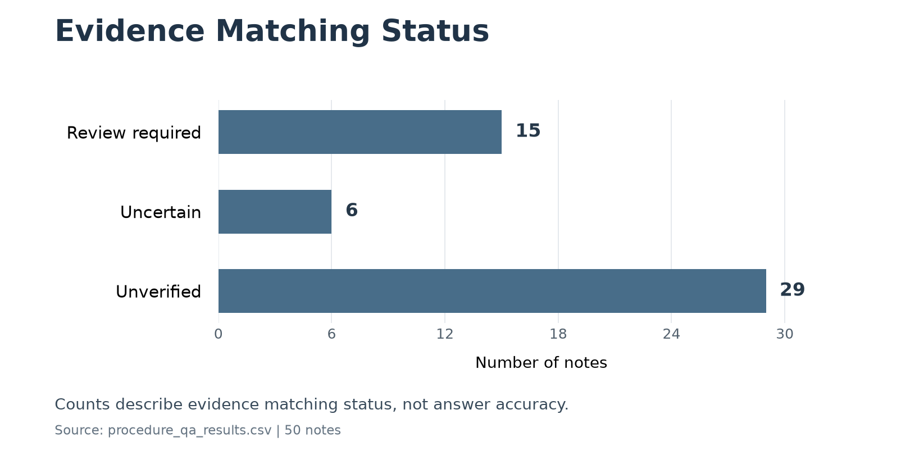

# OncoNote Explorer

A local Streamlit research demo for asking English questions about 50 sample oncology notes with **John Snow Labs Healthcare NLP**. For research use only; not a clinical decision tool. Generated answers can be incorrect or unsupported.

## Run the application

Use the existing WSL project and its two environments. No global installation or notebook execution is needed:

```bash
cd /home/sengul/projects/oncology-note-assistant
bash streamlit_demo/run.sh
```

Open http://localhost:8501. If that port already has this app running, use its existing process or stop that process before starting another copy. Select a note, expand its six-line preview with **Read more**, and submit an English question. The first question loads the cached model; later questions reuse it. The legacy `app.py` entry point also opens this same application.

- UI: `streamlit_demo/.venv/bin/python`, Python 3.12.9, Streamlit 1.34.0. `requirements.txt` records its UI dependency; do not install Healthcare NLP into this environment.
- QA worker: `spark/bin/python`, Python 3.12.9, PySpark 3.5.0, Spark NLP 7.0.0, Healthcare NLP 7.0.0, and `johnsnowlabs` 7.0.0. `requirements-qa.txt` is a version reference, not an installation command. The existing Java, JSL JARs, and local license are required.
- Model: the existing `~/cache_pretrained/clinical_notes_qa_base_onnx_pipeline_en_*` directory. No model download or remote QA service is used.

Optional environment variables: `ONCONOTE_QA_PYTHON` selects the existing licensed Python executable; `ONCONOTE_QA_MODEL` selects the existing pipeline directory (required if multiple matching cache directories exist). Neither variable contains a license key. JSL reads the existing local license installation. Never put license contents, tokens, or credentials in source control.

## Real QA and evidence selection

The UI caches a persistent local worker with `st.cache_resource`. JSON messages travel over private subprocess pipes, so the environments stay separate and no backend HTTP port is exposed. Calls are serialized. The worker starts bounded Spark `local[2]`, loads `PretrainedPipeline.from_disk(...)`, and answers with **`fullAnnotate([question], [context])`**, using the selected note as context. It checks for the `MedicalQuestionAnswering` stage. The pipeline is loaded once per worker, not once per question. A stopped or timed-out worker is recreated only on a later request. Missing cache, installation, license/startup, or inference failures produce an English error; there is no synthetic answer, keyword-QA fallback, or alternate model.

The generated **Model answer** and **Source evidence** are separate. Evidence selection is adapted from the notebook and runs **after** generation. It is a conservative lexical retrieval heuristic, not a JSL model-generated citation or clinical entailment validation. It uses sentence offsets, question/section relevance, answer-token order, numeric/negation checks, and abstention rules for planned care and visibly incomplete answers. A unique best match is labeled `lexical_match_review_required`. Tied matches are `ambiguous`; unsupported matches are `unverified`. Paraphrases may be missed, and these rules do not fully resolve temporality or clinical meaning. Model answer annotation offsets are not treated as source offsets.

Yellow highlighting marks only the selected exact occurrence in the chosen note, with its section heading and surrounding text. Text is HTML-escaped, and offsets are checked against the selected source before display. Repeated occurrences are never globally replaced. Answers without reliable evidence remain visibly unverified. Long notes may exceed the pretrained model's context capacity; absence of evidence is not proof that an answer is true or false.

Model interface: [John Snow Labs clinical notes QA pipeline](https://nlp.johnsnowlabs.com/2024/01/10/clinical_notes_qa_base_onnx_pipeline_en.html).

## Checks

```bash
streamlit_demo/.venv/bin/python -m unittest discover -s streamlit_demo -p test_*.py -v
streamlit_demo/.venv/bin/python streamlit_demo/smoke_test.py
```

The smoke test runs two real Healthcare NLP questions on `mt_oncology_1.txt`, checks source sections, and verifies one worker PID and one model load. It uses no test-double answers and needs the local licensed environment. UI error messages omit raw exception details and license values.

## Git and local data

Open `OncoNote.code-workspace` from this WSL project in VS Code (or run `code /home/sengul/projects/oncology-note-assistant` from WSL). The actual repository is on `main`, tracking `origin/main` at `https://github.com/sengulozaydin/oncology-note-assistant.git`. The Windows chat scratch folder is a different, empty Git repository and is not the application repository.

`.gitignore` excludes virtual environments, JSL/model caches, license/secret files, model weights, runtime logs, and private-data directories. The already tracked sample notes, historical notebook, and result exports are retained. Ignore rules do not remove already tracked files; do not replace these public sample artifacts with private patient data. Keep private notes outside the repository or in an ignored private directory. Only the bundled sample folder is selectable in this demo.

## Evidence Matching Status



These counts describe evidence matching status, not answer accuracy.
Source: [saved procedure QA results](results/procedure_qa_results.csv).

To regenerate the chart from the saved CSV without running the notebook or QA model,
run `python plot_evidence_status.py` in an environment with Matplotlib installed.
