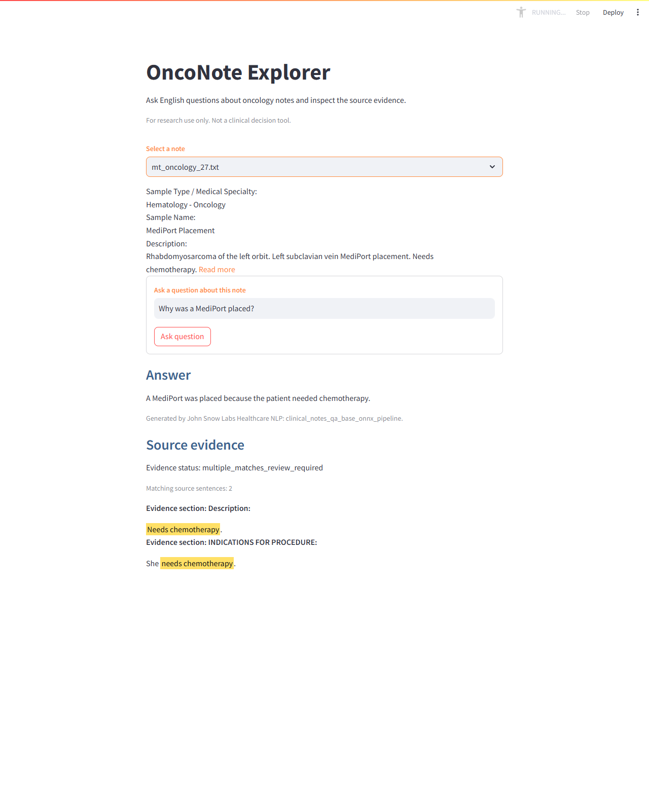

# OncoNote Explorer

**Ask English questions about oncology notes, then inspect the answer alongside matching source sentences.**

A local Streamlit research application powered by **John Snow Labs Healthcare NLP**, built on an existing Spark notebook and **50 sample oncology notes**. Answers come from the real cached clinical QA pipeline. Source matching runs separately after generation.

> For research and demonstration only. Not a clinical decision tool. Generated answers and source matches require review.

## Streamlit interface



1. Choose a note under **Select a note**.
2. Read its first six lines, or expand the wrapped preview with **Read more / Read less**.
3. Enter an English question under **Ask a question about this note**.
4. Inspect **Answer** and **Source evidence** separately. Matching sentences include section headings and yellow highlights.

The interface has orange input labels and blue result headings. It shows evidence status and match count, supports multiple source occurrences, and provides English messages for empty inputs, unavailable QA, and missing evidence. Explanatory footers have been removed from the interface; the matching method is documented below.

| Example note | Question |
| --- | --- |
| `mt_oncology_1.txt` | What was the postoperative diagnosis? |
| `mt_oncology_1.txt` | What anesthetic was injected? |
| `mt_oncology_8.txt` | What is the patient allergic to? |
| `mt_oncology_25.txt` | Why is the patient not a candidate for chlorambucil or radioactive phosphorus? |
| `mt_oncology_27.txt` | Why was a MediPort placed? |

## Healthcare NLP pipeline

The application uses [`clinical_notes_qa_base_onnx_pipeline`](https://nlp.johnsnowlabs.com/2024/01/10/clinical_notes_qa_base_onnx_pipeline_en.html), including its `MedicalQuestionAnswering` stage. It loads the local pipeline with `PretrainedPipeline.from_disk(...)` and submits the question and selected note through:

```python
annotations = pipeline.fullAnnotate([question], [context])
answer = annotations[0]['answer'][0].result
```

Answers are displayed verbatim. There is no alternate general-purpose model, synthetic answer, keyword-based QA fallback, or completion of model answers from source text.

```text
Streamlit UI → persistent local QA worker → cached Healthcare NLP → answer
                                                                  ↓
                         separate source matcher → highlighted sentences
```

`st.cache_resource` retains a QA client. Private JSON subprocess pipes connect the UI and licensed Python environments; no backend HTTP service is needed. Requests are serialized. The worker uses Spark `local[2]` and loads the model once per worker, so later questions reuse it. Missing installation, license, model cache, or failed inference produces an English error.

The cached pipeline's **30-token generation limit** could cut an answer mid-word. The app sets `maxNewTokens=128` in memory and rebuilds its LightPipeline once after loading. The same model, prompt, deterministic decoding and end-of-sequence behavior are retained. This reduces truncation without guaranteeing completeness. Cached model files are neither modified nor downloaded.

## Source matching: what the highlights mean

**Source evidence is a lexical match, not a model-validated citation or a clinical entailment judgment.**

In the inspected real pipeline output, answer annotation offsets referred to the generated answer, not its position in the note. No source-span field was present in that output. The app therefore computes source offsets independently.

- Sentences retain their original text, section headings and character offsets.
- Answer-specific tokens are matched in order; section relevance helps rank candidates.
- Bounded word-form normalization handles examples such as `needs / needed`. Numbers and negation checks remain in place; clinical synonyms and fuzzy drug names are not substituted.
- A single-word field such as `ALLERGIES: Penicillin` requires a matching full field and a question-relevant heading.
- Planned-care sentences are eligible only for planned-care questions with matching modality markers. A plan is not treated as a completed procedure.
- All equally ranked matches are shown, including repeated sentences in different sections. No arbitrary primary match is chosen.
- Only answer-related spans are highlighted. Additional source words remain visible without highlighting. HTML is escaped and source offsets are validated.

| Status | Meaning |
| --- | --- |
| `lexical_match_review_required` | One source sentence meets the matching rules. |
| `multiple_matches_review_required` | Multiple equally ranked source occurrences are shown. |
| `partial_match_review_required` | A supported list comparison found source items missing from the answer; review the completeness warning. |
| `unverified` | No source match met the rules. |

These statuses describe **matching, not answer accuracy**. Paraphrases may be missed; lexical overlap does not resolve clinical meaning, attribution, or every temporal relationship. List-completeness checks are narrow. Long notes may exceed the model's context capacity. A highlight does not establish correctness, and an unverified answer is not automatically false.

## Setup

### Prerequisites

The tested system is **WSL/Ubuntu with Python 3.12.9**. QA requires the existing Java/Spark installation, a valid John Snow Labs license, locally installed licensed packages/JARs, and an already cached pipeline. Licenses and model weights are not included in this repository.

| Environment | Purpose | Tested dependencies |
| --- | --- | --- |
| `streamlit_demo/.venv` | UI and QA client | Streamlit 1.34.0 |
| `spark` | Licensed QA worker | PySpark 3.5.0, Spark NLP 7.0.0, Healthcare NLP 7.0.0, johnsnowlabs 7.0.0 |

For a new checkout:

```bash
git clone https://github.com/sengulozaydin/oncology-note-assistant.git
cd oncology-note-assistant

# Create only if this UI environment does not already exist.
python3.12 -m venv streamlit_demo/.venv
streamlit_demo/.venv/bin/python -m pip install -r streamlit_demo/requirements.txt
```

For the existing project, reuse both environments. Do not install Streamlit globally or put the licensed stack in the UI environment. `requirements-qa.txt` records tested versions; it is not a standalone licensed installation command. For a new licensed setup, follow the [John Snow Labs installation guide](https://nlp.johnsnowlabs.com/docs/en/licensed_install), then point the app at that environment and an existing pipeline cache. Application startup does not download missing packages or models.

By default, the worker uses `spark/bin/python` and discovers one pipeline under `~/cache_pretrained/clinical_notes_qa_base_onnx_pipeline_en_*`. Optional overrides:

```bash
export ONCONOTE_QA_PYTHON=/absolute/path/to/licensed-environment/bin/python
export ONCONOTE_QA_MODEL=/absolute/path/to/cached/pipeline
```

The pipeline directory must contain `metadata/` and `stages/`. Set the model override when multiple matching caches exist. Keep license material in the local JSL installation, outside source control.

## Run locally

From the repository root:

```bash
bash streamlit_demo/run.sh
```

Open **http://localhost:8501**. To use port 8502 instead:

```bash
streamlit_demo/.venv/bin/python -m streamlit run streamlit_demo/app.py \
  --server.address 127.0.0.1 --server.port 8502 \
  --browser.gatherUsageStats false
```

The launcher binds to localhost and disables usage statistics. Reuse an already running instance where possible. Root `app.py` also opens the same application. Notebook execution is not required.

If QA cannot start, check the licensed Python path, local JSL installation/license, cached model path, Java and available memory. A timed-out worker is stopped and recreated on a later request. Error messages avoid exposing raw license values.

## Tests and validation

Fast tests, without loading the QA model:

```bash
streamlit_demo/.venv/bin/python -m unittest discover -s streamlit_demo -p 'test_*.py' -v
```

Real-model integration test, requiring the licensed local environment:

```bash
streamlit_demo/.venv/bin/python streamlit_demo/smoke_test.py
```

Run the smoke test without another loaded QA worker on memory-constrained machines; each worker starts its own Spark/model process.

The smoke test asks two real questions about `mt_oncology_1.txt`, checks source sections, and verifies one worker PID and one model load. It uses no test-double answers.

The current suite has **27 passing tests** covering UI validation, error handling, offsets, HTML escaping, repeated matches, word forms, partial lists, negation, doses, short fields and planned care. Browser checks also exercised **11 questions across 9 notes** with real model responses; all selected cases produced source matches after the fixes. This is functional regression testing, not a clinical accuracy benchmark or exhaustive evaluation.

## Notebook and saved results

[`oncology_spark_lab.ipynb`](oncology_spark_lab.ipynb) preserves the original work: loading 50 text notes, oncology NER with clinical embeddings and `ner_oncology`, clinical QA, and source rendering. The Streamlit QA flow does not run the NER pipeline for each question.

- [`procedure_qa_results.csv`](results/procedure_qa_results.csv): saved per-note questions, answers and evidence fields.
- [`procedure_qa_report.html`](results/procedure_qa_report.html): readable highlighted source report; download and open locally.
- [`evidence_matching_status.png`](results/evidence_matching_status.png): chart based on the saved procedure results.


These counts describe the **historical evidence-matching run**, not answer accuracy or a fresh evaluation of the current Streamlit matcher. Regenerate the chart with `python plot_evidence_status.py` in an environment with Matplotlib; no notebook or QA execution is needed.

## Repository layout

```text
oncology_spark_lab.ipynb       Original Spark / Healthcare NLP notebook
mt_onc_50/                   50 sample notes
streamlit_demo/
  app.py                     Streamlit interface
  qa_client.py               Persistent subprocess client
  qa_worker.py               Licensed cached-pipeline inference
  evidence.py                Source matching and highlighting
  requirements.txt           UI dependency
  requirements-qa.txt        Licensed environment version reference
  run.sh                     Local launcher
  test_app.py                UI validation tests
  test_evidence.py           Evidence regression tests
  smoke_test.py              Real-model integration checks
results/                     Historical CSV, HTML report and chart
docs/images/                 Application screenshot
OncoNote.code-workspace      VS Code workspace for the WSL repository
```

## Data and credentials

Use the bundled sample notes for demonstrations. This is not a private clinical-data ingestion system. Do not commit patient records, license files, tokens, environments or model caches. `.gitignore` covers common credentials, weights, runtime artifacts and private-data folders. Already tracked sample notes and historical artifacts remain tracked; ignore rules do not protect sensitive files already committed.

## Resources

- [Healthcare NLP clinical notes QA pipeline](https://nlp.johnsnowlabs.com/2024/01/10/clinical_notes_qa_base_onnx_pipeline_en.html)
- [Licensed installation guide](https://nlp.johnsnowlabs.com/docs/en/licensed_install)
- [Healthcare NLP Python API](https://nlp.johnsnowlabs.com/licensed/api/python/)
- [Medical language model training notebooks](https://github.com/JohnSnowLabs/spark-nlp-workshop/tree/master/tutorials/Certification_Trainings/Medical_Language_Models)
